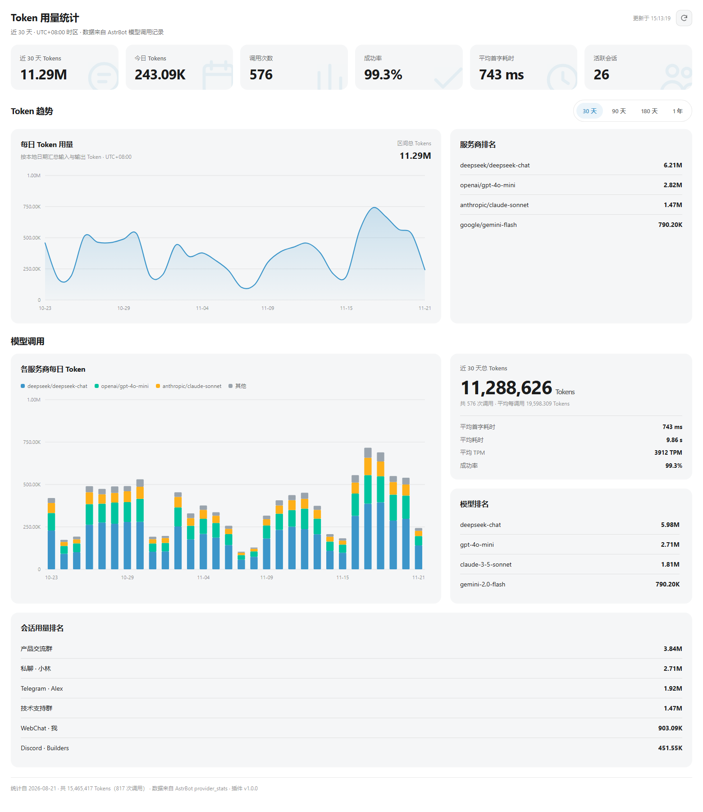

# AstrBot Token 用量插件

在 AstrBot WebUI 中以「数据与日志 → 统计」同款界面查看最近 **30 天 / 90 天 / 180 天 / 1 年** 的 Token 使用情况。

数据直接读取 AstrBot 自带的 `provider_stats` 表，只读、不落盘、不修改任何用户数据，也不引入任何第三方依赖。



> 页面风格参考 AstrBot 内置「数据与日志 → 统计」页，布局与交互保持一致；图表使用原生 SVG 实现，离线可用。深色主题预览见 [`docs/preview-dark.png`](docs/preview-dark.png)。

## 功能

- **概览卡片**：区间 Token 总量、今日 Tokens、调用次数、成功率、平均首字耗时、活跃会话数。
- **Token 趋势**：按本地日期汇总的每日 Token 面积图，悬停查看精确数值。
- **模型调用**：各服务商每日 Token 堆叠柱状图、服务商排名、模型排名。
- **会话用量排名**：按 UMO 汇总的会话 Token 用量 Top 10，支持 AstrBot 的会话别名。
- **范围切换**：近 30 天、90 天、180 天、1 年，切换后立即重新统计。
- **实时性**：页面每 60 秒自动刷新；后端内置 30 秒短缓存，避免重复扫描数据库。
- **主题与语言**：跟随 AstrBot WebUI 的明暗主题与语言（简体中文 / English）。
- **稳定优先**：数据库异常、空数据、旧版本 AstrBot 均会显示可读提示而不是崩溃；插件可随时在 WebUI 中重载或更新。

## 环境要求

- AstrBot `>= 4.24.2, < 5`（开发与验证版本：`4.29.4`）。
- 无需额外 Python 依赖，无需 `requirements.txt`。
- 使用 AstrBot 默认的 SQLite 数据库（`data/data_v4.db` 的 `provider_stats` 表）。

## 安装

### 方式一：WebUI 安装（推荐）

在 AstrBot WebUI 的 `插件 → 已安装 → 安装插件` 中：

- 填写本仓库地址 `https://github.com/ar-ford/astrbot_plugin_token_usage`；或
- 上传本仓库打包的 ZIP。

### 方式二：手动安装

把整个插件目录放到 AstrBot 的 `data/plugins/` 下：

```text
AstrBot/data/plugins/astrbot_plugin_token_usage/
├─ main.py
├─ metadata.yaml
├─ pages/token-usage/
└─ .astrbot-plugin/i18n/
```

然后在 WebUI 的插件页点击该插件卡片上的刷新/重载按钮，或重启 AstrBot。

## 使用

1. 打开 AstrBot WebUI → `插件`；
2. 点击 `Token 用量` 插件卡片，进入插件详情页，打开 `Token 用量` 视图；
   - AstrBot 4.29 及以上也可以在左侧 `扩展功能 → 插件视图` 中直接打开；
3. 页面默认展示最近 30 天，点击右上角范围按钮切换统计周期。

> 页面数据来自 AstrBot 对模型调用的记录。如果是刚安装 AstrBot，需要先产生一些模型调用，页面才会显示数据。

## 更新

插件元数据中的 `repo` 已指向 GitHub 仓库，AstrBot 可以直接检查并更新：

1. 修改代码后，同步更新 `metadata.yaml` 中的 `version`；
2. 提交并推送到 GitHub；
3. 在 AstrBot WebUI 的插件页点击 `更新`。

首次发布到仓库时，可以在插件目录中执行：

```bash
git init
git add .
git commit -m "feat: token usage plugin v1.0.0"
git branch -M main
git remote add origin https://github.com/ar-ford/astrbot_plugin_token_usage.git
git push -u origin main
```

之后每次发版只需提升 `metadata.yaml` 的 `version` 并推送。插件不在自身目录保存任何运行数据，因此更新、重装不会丢失统计（统计本身来自 AstrBot 数据库）。

> 如果远端仓库里已经有手动上传的 ZIP 等内容、与本地历史没有关联，首次推送需要执行 `git push -u origin main --force` 用插件源码仓库替换远端内容。

## 实现说明

- `main.py` 注册 `GET /astrbot_plugin_token_usage/stats`，读取 `provider_stats` 表，在 SQLite 中按 UTC 小时聚合，再用 Python 换算成本地日期，避免一次性把整月数据读进内存。
- 统计只包含 `agent_type = internal` 的记录，与 AstrBot 内置统计页口径一致。
- 页面位于 `pages/token-usage/`（AstrBot 同时兼容 `views/` 新目录名；`pages/` 可覆盖更旧的 4.x 版本），脚本仅通过 `window.AstrBotPluginView` bridge 调用后端，不访问父页面 DOM、Cookie 或 LocalStorage。
- 图表为原生 SVG + CSS，不依赖 CDN 或前端构建步骤，离线环境也能正常显示。

## 目录结构

```text
astrbot_plugin_token_usage/
├─ main.py                         # 插件入口与统计接口
├─ metadata.yaml                   # 插件元数据（名称、版本、仓库、AstrBot 版本范围）
├─ logo.png                        # 插件 Logo
├─ pages/token-usage/
│  ├─ index.html                   # 视图入口
│  ├─ style.css                    # 与 AstrBot 统计页一致的视觉样式
│  ├─ app.js                       # 数据加载、渲染与自动刷新
│  └─ charts.js                    # 原生 SVG 面积图 / 堆叠柱状图
├─ .astrbot-plugin/i18n/
│  ├─ zh-CN.json                   # 视图标题、描述与界面文案
│  └─ en-US.json
├─ README.md
├─ CHANGELOG.md
└─ LICENSE
```

## 常见问题

**打开视图后提示“未检测到 AstrBot 插件视图桥接”？**

请从 AstrBot WebUI 的插件详情页/侧边栏进入视图，不要直接双击 `index.html`。

**页面显示 0 或“暂无数据”？**

说明该统计周期内没有 `provider_stats` 记录。AstrBot 只记录实际发生的模型调用；确认机器人已经正常回复过消息。

**统计范围里只有 30 天可选？**

范围按钮在页面右上角；如果窗口较窄，按钮会自动换行。插件支持 30 / 90 / 180 / 365 天。

**升级 AstrBot 后页面样式异常？**

插件通过 `data-theme` 和 CSS 变量适配主题，不依赖 Dashboard 内部组件。如果 AstrBot 大幅修改主题变量，可重载插件并刷新页面；仍异常请附上页面截图和 AstrBot 版本反馈。

## 开发与验证

- 后端聚合逻辑可用 `.test/` 下的脚本在真实数据库快照上验证（不包含在插件发布包内）。
- 页面可在 `pages/token-usage/` 直接静态预览；实际数据由 AstrBot bridge 提供。
- 修改后端后，在插件页点击重载即可生效；修改静态资源刷新视图即可。

## 许可

MIT License。界面布局参考 AstrBot 内置统计页（AGPL-3.0）的视觉设计，未复制其前端源码。
